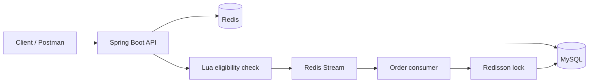

# LocalPerks Backend API

LocalPerks is a Redis-powered backend for discovering local businesses, publishing community posts, and claiming limited-time offers. It demonstrates production-oriented Redis patterns in a compact Spring Boot application.

## Highlights

- Passwordless login with E.164 phone numbers and Redis-backed verification codes
- Token-based authentication with sliding expiration
- Cache-aside, cache penetration protection, logical expiration, and mutex rebuilds
- Globally unique order IDs generated with Redis
- Atomic inventory and one-claim-per-user checks with Lua
- Distributed order locks with Redisson
- Asynchronous order persistence with Redis Streams and pending-message recovery
- Likes, follows, and a personalized activity feed

## Architecture



The HTTP request only performs the atomic Redis eligibility check and returns an order ID. A background consumer persists the accepted order to MySQL. Stream consumer groups are created automatically at startup.

## Technology

- Java 8
- Spring Boot 2.3
- MyBatis-Plus 3.4
- MySQL 5.7
- Redis 6.2
- Redisson 3.13
- Maven

## Quick start with Docker

Requirements: Docker with Compose support.

```bash
cp .env.example .env
docker compose up --build
```

The API is available at:

```text
http://localhost:8081/api/v1
```

MySQL is initialized from `src/main/resources/db/localperks.sql`. Redis and MySQL data are stored in named Docker volumes.

To inspect verification codes in this demo environment, set this in `.env` before starting the stack:

```text
APP_LOG_LEVEL=debug
```

Then inspect the API logs:

```bash
docker compose logs -f api
```

Do not log verification codes in a production deployment. Replace the demo logger with a real SMS provider.

## Run locally

Requirements:

- JDK 8+
- Maven 3.6+
- MySQL 5.7+
- Redis 5+

1. Create a `localperks` database and import `src/main/resources/db/localperks.sql`.
2. Set the environment variables shown in `.env.example`, or create an ignored `src/main/resources/application-local.yaml`.
3. Start the application:

```bash
mvn spring-boot:run
```

The maintainer's machine-specific configuration is intentionally excluded from Git.

## Authentication example

Phone numbers must use E.164 format. Encode the leading `+` as `%2B` when it appears in a URL query string.

Request a code:

```bash
curl -X POST "http://localhost:8081/api/v1/users/code?phone=%2B14155552671"
```

Log in:

```bash
curl -X POST "http://localhost:8081/api/v1/users/login" \
  -H "Content-Type: application/json" \
  -d '{"phone":"+14155552671","code":"123456"}'
```

Use the returned token:

```bash
curl "http://localhost:8081/api/v1/users/me" \
  -H "Authorization: Bearer YOUR_TOKEN"
```

## Core endpoints

| Method | Endpoint | Authentication | Purpose |
|---|---|---:|---|
| POST | `/api/v1/users/code` | No | Request a verification code |
| POST | `/api/v1/users/login` | No | Log in and receive a token |
| POST | `/api/v1/users/logout` | Yes | Revoke the current token |
| GET | `/api/v1/users/me` | Yes | Get the current user |
| GET | `/api/v1/businesses/{id}` | No | Get a local business |
| GET | `/api/v1/business-types/list` | No | List business categories |
| GET | `/api/v1/offers/list/{businessId}` | No | List a business's offers |
| POST | `/api/v1/offers/{id}/claim` | Yes | Claim a limited-time offer |
| GET | `/api/v1/posts/hot` | No | List popular community posts |

A ready-to-import Postman collection is available in `postman/LocalPerks.postman_collection.json`.

## Configuration

| Variable | Default | Description |
|---|---|---|
| `SERVER_PORT` | `8081` | HTTP port |
| `MYSQL_URL` | Local `localperks` database | JDBC URL |
| `MYSQL_USERNAME` | `root` | Database user |
| `MYSQL_PASSWORD` | Empty | Database password |
| `REDIS_HOST` | `localhost` | Redis host |
| `REDIS_PORT` | `6379` | Redis port |
| `REDIS_PASSWORD` | Empty | Redis password |
| `IMAGE_UPLOAD_DIR` | `./data/images` | Image storage directory |
| `ORDER_STREAM_KEY` | `stream.orders` | Redis order stream |
| `ORDER_STREAM_GROUP` | `order-workers` | Consumer group |
| `ORDER_STREAM_CONSUMER` | `consumer-1` | Consumer name |

## Verification

```bash
mvn test
mvn clean package
```

## Project status

This repository is a portfolio and learning project, not a hosted commercial service. The code began as a Redis practice project and was independently reorganized into LocalPerks with international phone support, secure configuration, containerized startup, Stream initialization, idempotent asynchronous persistence, and English documentation.

Before redistributing third-party course assets or sample data, verify that their original license permits publication.
