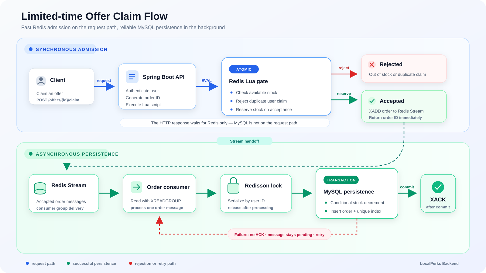

# LocalPerks Backend

[](https://github.com/hatakaiforcanada-ship-it/localperks-backend/actions/workflows/build.yml)

LocalPerks is a Spring Boot backend for discovering local businesses, sharing community posts, and claiming limited-time offers.

The main engineering focus is the offer-claim path: Redis Lua handles stock reservation atomically, Redis Streams move accepted orders to background processing, and MySQL provides transactional persistence and database-level idempotency.

## Features

- Passwordless login with E.164 phone-number validation
- Redis-based verification codes, login tokens, and token expiration
- Business and business-category discovery
- Community posts, likes, follows, and comments
- Cache-aside reads with penetration and breakdown protection
- Atomic offer reservation with Redis Lua
- Asynchronous order processing with Redis Streams
- Per-user order coordination with Redisson
- MySQL stock validation and duplicate-order protection
- Docker Compose development environment
- Postman API collection and Maven tests

## Tech Stack

- **Backend:** Java 8, Spring Boot 2.3, MyBatis-Plus
- **Data:** MySQL 5.7, Redis 6.2
- **Concurrency:** Redis Lua, Redis Streams, Redisson
- **Build and testing:** Maven, JUnit 5, Mockito
- **Environment:** Docker, Docker Compose, GitHub Actions

## Offer Claim Flow



The HTTP request performs only the Redis admission step.

A Lua script checks stock, rejects duplicate claims, reserves inventory, and appends the accepted order to Redis Streams as one atomic operation. The client receives the generated order ID without waiting for a MySQL transaction.

A background consumer reads the order, acquires a per-user Redisson lock, and writes it to MySQL. The message is acknowledged only after the database transaction completes successfully. Failed messages remain pending and can be retried.

## Implementation Highlights

### Redis Caching

[`CacheClient`](src/main/java/com/localperks/utils/CacheClient.java) provides three cache access strategies:

- Cache-aside queries with short-lived null values
- Mutex-based cache rebuilding with Redisson
- Logical expiration with background rebuilding

Mutex retries are bounded, cache contents are checked again after acquiring the lock, and a lock is released only when it is still owned by the current thread.

Business detail queries currently use the cache-aside strategy through [`ShopServiceImpl`](src/main/java/com/localperks/service/impl/ShopServiceImpl.java).

### Atomic Offer Reservation

[`seckill.lua`](src/main/resources/seckill.lua) performs the following operations atomically:

1. Check remaining Redis stock
2. Check whether the user has already claimed the offer
3. Decrement Redis stock
4. Record the user claim
5. Append the order to Redis Streams

This prevents concurrent requests from interleaving between stock validation and reservation.

### Asynchronous Order Persistence

[`VoucherOrderServiceImpl`](src/main/java/com/localperks/service/impl/VoucherOrderServiceImpl.java) consumes accepted orders through a Redis Stream consumer group.

[`VoucherOrderPersistenceService`](src/main/java/com/localperks/service/impl/VoucherOrderPersistenceService.java) handles the MySQL transaction:

- Check for an existing order
- Decrement stock with a `stock > 0` condition
- Insert the order
- Rely on the `(user_id, voucher_id)` unique index as the final duplicate-order safeguard

### Redis Login Session

After login, a generated token is stored in Redis together with a minimal user profile.

`RefreshTokenInterceptor` reads the token, restores the user into `UserHolder`, and refreshes its expiration. `LoginInterceptor` then protects endpoints that require an authenticated user.

## Getting Started

### Requirements

- Docker
- Docker Compose

### Start the application

```bash
git clone https://github.com/hatakaiforcanada-ship-it/localperks-backend.git
cd localperks-backend
cp .env.example .env
docker compose up --build
```

PowerShell:

```powershell
Copy-Item .env.example .env
docker compose up --build
```

The Compose environment starts:

- LocalPerks API
- MySQL
- Redis

MySQL is initialized with the schema and sample data from [`localperks.sql`](src/main/resources/db/localperks.sql).

API base URL:

```text
http://localhost:8081/api/v1
```

## Try the API

Set `APP_LOG_LEVEL=debug` in `.env` to print the demo verification code in the application log.

### 1. Request a verification code

```bash
curl -X POST "http://localhost:8081/api/v1/users/code?phone=%2B819012345678"
```

### 2. Log in

```bash
curl -X POST "http://localhost:8081/api/v1/users/login" \
  -H "Content-Type: application/json" \
  -d '{"phone":"+819012345678","code":"CODE_FROM_LOG"}'
```

### 3. Get the current user

```bash
curl "http://localhost:8081/api/v1/users/me" \
  -H "Authorization: Bearer YOUR_TOKEN"
```

### 4. Claim an offer

```bash
curl -X POST "http://localhost:8081/api/v1/offers/19/claim" \
  -H "Authorization: Bearer YOUR_TOKEN"
```

A ready-to-import collection is available at [`postman/LocalPerks.postman_collection.json`](postman/LocalPerks.postman_collection.json).

## Core API

| Method | Endpoint | Description |
|---|---|---|
| POST | `/users/code` | Request a demo verification code |
| POST | `/users/login` | Log in and receive a token |
| POST | `/users/logout` | Remove the current login token |
| GET | `/users/me` | Get the current user |
| GET | `/business-types/list` | List business categories |
| GET | `/businesses/{id}` | Get a cached business |
| GET | `/businesses/of/type` | List businesses by category |
| GET | `/offers/list/{businessId}` | List offers for a business |
| POST | `/offers/{id}/claim` | Claim a limited-time offer |
| GET | `/posts/hot` | List popular community posts |

All endpoints use the `/api/v1` context path.

## Testing

Run the test suite:

```bash
mvn test
```

Build the application:

```bash
mvn clean package
```

The current test suite contains 11 unit tests covering:

- Bearer-token parsing
- E.164 phone-number validation
- Cache mutex retry limits
- Lock ownership and safe release
- Cache recheck after lock acquisition
- Null-value caching
- Logical-expiration rebuild coordination

GitHub Actions runs the Maven test suite automatically on each push.

## Code Guide

- [CacheClient](src/main/java/com/localperks/utils/CacheClient.java)
- [Offer reservation Lua script](src/main/resources/seckill.lua)
- [Order request and Stream consumer](src/main/java/com/localperks/service/impl/VoucherOrderServiceImpl.java)
- [Transactional order persistence](src/main/java/com/localperks/service/impl/VoucherOrderPersistenceService.java)
- [Authentication interceptor configuration](src/main/java/com/localperks/config/MvcConfig.java)
- [Database schema and sample data](src/main/resources/db/localperks.sql)
- [Postman collection](postman/LocalPerks.postman_collection.json)
