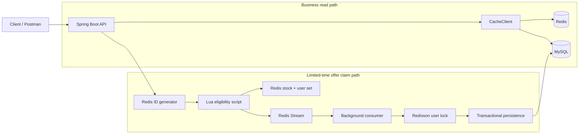

# LocalPerks Backend

[](https://github.com/hatakaiforcanada-ship-it/localperks-backend/actions/workflows/build.yml)

LocalPerks is a learning and portfolio backend for local business discovery, community posts, and limited-time offers. The project focuses on practical Redis usage: cache protection, token storage, atomic eligibility checks, distributed locking, and asynchronous order persistence with Redis Streams.

This repository is not presented as a commercial production system. It began as a Redis tutorial project and was reorganized and extended to demonstrate the author's understanding of Java backend development, concurrency control, data consistency, and engineering practices.

## Key Features

- Passwordless demo login with E.164 phone-number validation
- Verification codes and login tokens stored in Redis with expiration
- Cache-aside reads and null-value caching for cache penetration protection
- Redisson-based mutex rebuild and logical-expiration strategies in a reusable cache client
- Redis-generated globally unique order IDs
- Atomic stock validation, stock decrement, duplicate-claim prevention, and Stream insertion through Lua
- Redis Stream consumer with pending-message retry
- Transactional MySQL inventory decrement and order persistence
- Database unique constraint for one claim per user and offer
- Docker Compose setup, externalized configuration, Postman examples, Maven build, and GitHub Actions

## Tech Stack

| Area | Technology | Version used by this repository |
|---|---|---|
| Language | Java | 8 source/target; Java 8 in Docker and CI |
| Framework | Spring Boot | 2.3.12.RELEASE |
| Persistence | MyBatis-Plus | 3.4.3 |
| Database | MySQL | 5.7 Docker image; Connector/J 5.1.47 |
| Cache and messaging | Redis | 6.2 Docker image |
| Distributed lock | Redisson | 3.13.6 |
| Testing | JUnit Jupiter / Mockito | 5.6.3 / 3.3.3 |
| Build | Maven | Maven Wrapper is not included |

These versions reflect the current codebase rather than a recommendation for new production systems. Modernization is listed under [Limitations & Future Improvements](#limitations--future-improvements).

## Architecture



An accepted claim request returns an order ID after the Lua script completes. MySQL persistence happens asynchronously. The Stream message is acknowledged only after persistence succeeds; failures remain pending and are retried by the current consumer.

More detail is available in [docs/architecture.md](docs/architecture.md).

## Technical Highlights

### Redis cache design

[`CacheClient`](src/main/java/com/localperks/utils/CacheClient.java) contains three explicit cache access strategies:

- **Cache-aside with penetration protection:** missing database records are cached as empty values for a short TTL.
- **Mutex rebuild:** one caller acquires a Redisson lock, checks the cache again, loads the database, and populates Redis. Other callers use a bounded retry loop instead of recursive, unbounded waiting.
- **Logical expiration:** stale data is returned immediately while one background task attempts to rebuild the entry. Both an in-process rebuilding-key set and a Redisson lock reduce duplicate rebuilds.

The current business detail endpoint uses the cache-aside/pass-through strategy in [`ShopServiceImpl`](src/main/java/com/localperks/service/impl/ShopServiceImpl.java). Mutex and logical-expiration methods are reusable strategies and are covered by focused unit tests; they are not the default path for every endpoint.

### Limited-time offer processing

The claim path is implemented across [`seckill.lua`](src/main/resources/seckill.lua), [`VoucherOrderServiceImpl`](src/main/java/com/localperks/service/impl/VoucherOrderServiceImpl.java), and [`VoucherOrderPersistenceService`](src/main/java/com/localperks/service/impl/VoucherOrderPersistenceService.java):

1. The API obtains the current user and generates an order ID through Redis.
2. Lua checks Redis inventory and the per-offer user set atomically.
3. On success, the same script decrements inventory, records the user, and appends the order to a Redis Stream.
4. A background consumer reads the Stream through a consumer group.
5. A Redisson lock serializes order handling for the same user.
6. A MySQL transaction checks for an existing order, decrements database inventory with `stock > 0`, and inserts the order.
7. The message is acknowledged only after the persistence method returns successfully.

The schema also defines a unique `(user_id, voucher_id)` index in [`localperks.sql`](src/main/resources/db/localperks.sql). This is the final database-level safeguard against duplicate claims.

### Login and configuration

Successful login stores a minimal user hash under a generated token. `RefreshTokenInterceptor` restores the user into a `ThreadLocal` holder and refreshes the Redis TTL. The project keeps machine-specific configuration out of Git through `.env`, environment variables, and an ignored `application-local.yaml`.

Verification codes are written to application logs only when debug logging is enabled. No SMS provider is integrated.

## Getting Started

### Docker Compose

Requirements: Docker with Compose support.

Create a local environment file:

```bash
cp .env.example .env
```

PowerShell equivalent:

```powershell
Copy-Item .env.example .env
```

Review the placeholder passwords in `.env`, then start the stack:

```bash
docker compose up --build
```

The API base URL is:

```text
http://localhost:8081/api/v1
```

On the first startup with an empty MySQL volume, Docker imports [`localperks.sql`](src/main/resources/db/localperks.sql). The script contains fictional Japanese-language demo data for Tokyo-area businesses and uses placeholder image paths.

To recreate the database from the initialization script, remove the named volumes before restarting:

```bash
docker compose down -v
docker compose up --build
```

> `docker compose down -v` permanently deletes the Compose-managed MySQL, Redis, and uploaded-image data. The Compose configuration is intended for local development and exposes MySQL and Redis ports on the host.

### Local application run

Requirements:

- JDK 8 or later
- Maven 3.6 or later
- A MySQL-compatible database initialized with `src/main/resources/db/localperks.sql`
- Redis 5 or later

Set the variables documented in `.env.example`, or create the ignored file `src/main/resources/application-local.yaml` and activate it explicitly:

```powershell
$env:SPRING_PROFILES_ACTIVE = "local"
mvn spring-boot:run
```

The default configuration is defined in [`application.yaml`](src/main/resources/application.yaml).

### Demo login

Phone numbers must use E.164 format. Encode the leading `+` as `%2B` in a URL query string.

Enable `APP_LOG_LEVEL=debug` in a local demo environment, request a code, and read it from the application log:

```bash
curl -X POST "http://localhost:8081/api/v1/users/code?phone=%2B819012345678"
```

```bash
curl -X POST "http://localhost:8081/api/v1/users/login" \
  -H "Content-Type: application/json" \
  -d '{"phone":"+819012345678","code":"CODE_FROM_LOG"}'
```

```bash
curl "http://localhost:8081/api/v1/users/me" \
  -H "Authorization: Bearer YOUR_TOKEN"
```

Do not enable verification-code logging in a public deployment.

### Core API examples

| Method | Endpoint | Purpose |
|---|---|---|
| POST | `/api/v1/users/code` | Generate a demo verification code |
| POST | `/api/v1/users/login` | Exchange phone and code for a token |
| POST | `/api/v1/users/logout` | Delete the current token |
| GET | `/api/v1/users/me` | Return the current token user |
| GET | `/api/v1/business-types/list` | List business categories |
| GET | `/api/v1/businesses/{id}` | Get a business, using the cache-aside path |
| GET | `/api/v1/businesses/of/type` | List businesses by type |
| GET | `/api/v1/offers/list/{businessId}` | List offers for a business |
| POST | `/api/v1/offers/{id}/claim` | Submit a limited-time offer claim |
| GET | `/api/v1/posts/hot` | List posts ordered by like count |

The claim example should include `Authorization: Bearer <token>`. A ready-to-import collection is available at [postman/LocalPerks.postman_collection.json](postman/LocalPerks.postman_collection.json).

### Configuration reference

| Variable | Application default | Purpose |
|---|---|---|
| `SERVER_PORT` | `8081` | HTTP port |
| `CONTEXT_PATH` | `/api/v1` | API context path |
| `MYSQL_URL` | Local `localperks` database | JDBC URL |
| `MYSQL_USERNAME` | `root` | Database user |
| `MYSQL_PASSWORD` | Empty | Database password |
| `REDIS_HOST` | `localhost` | Redis host |
| `REDIS_PORT` | `6379` | Redis port |
| `REDIS_PASSWORD` | Empty | Redis password for a local application run |
| `REDIS_DATABASE` | `0` | Redis logical database |
| `IMAGE_UPLOAD_DIR` | `./data/images` | Image storage directory |
| `ORDER_STREAM_KEY` | `stream.orders` | Redis order Stream |
| `ORDER_STREAM_GROUP` | `order-workers` | Consumer group |
| `ORDER_STREAM_CONSUMER` | `consumer-1` | Consumer name |
| `APP_LOG_LEVEL` | `info` | Application package log level |

`MYSQL_DATABASE` and `MYSQL_ROOT_PASSWORD` are additionally used by Docker Compose. The current Compose file starts Redis without authentication and passes an empty Redis password to the application.

## Testing

Run the unit test suite:

```bash
mvn test
```

Build the executable JAR and run the same tests:

```bash
mvn clean package
```

The latest local execution completed **11 tests with 0 failures and 0 errors**:

| Test class | Tests | Verified behavior |
|---|---:|---|
| `AuthTokenUtilsTest` | 3 | Bearer-token parsing and blank-header handling |
| `RegexUtilsTest` | 2 | Accepted and rejected E.164 phone-number formats |
| `CacheClientTest` | 6 | Bounded mutex retries, lock ownership, cache recheck, null caching, and logical-expiration rebuild coordination |

`CacheClientTest` uses Mockito and controlled worker-thread coordination. It does not claim a Redis throughput or QPS result. Real Redis/MySQL concurrency, Lua inventory, Stream pending recovery, and end-to-end order persistence tests have been designed but are **not yet implemented or reported as passing**.

GitHub Actions currently runs `mvn -B test` on Java 8. See [the build workflow](.github/workflows/build.yml).

## Design Decisions

### Why use Lua for offer eligibility?

The stock check, duplicate-user check, stock decrement, user-set update, and Stream append must be treated as one Redis operation. Executing them as separate client commands would allow concurrent requests to interleave between checks and updates. Redis executes the Lua script atomically, so an accepted result corresponds to one inventory reservation and one Stream message.

### Why persist orders asynchronously with Redis Streams?

The request path performs only the Redis eligibility step and returns the generated order ID without waiting for MySQL writes. The Stream separates request admission from database persistence and provides a pending list for messages that were delivered but not acknowledged. This reduces request-path work, but introduces eventual consistency and recovery responsibilities.

### Why keep MySQL idempotency checks after Redis duplicate checks?

Redis protects the normal admission path, but Stream delivery is at-least-once and a message may be retried. Redis state can also be rebuilt or become inconsistent with the database. The persistence service therefore checks existing orders, while the unique `(user_id, voucher_id)` index enforces the rule at the database boundary.

### Why use logical expiration for hot data?

For a hot key, deleting an expired value can cause many requests to wait for or compete over a database rebuild. Logical expiration keeps a stale value available while one worker refreshes it. This favors availability and predictable read latency at the cost of temporarily serving stale data. The strategy exists in `CacheClient`; it is not enabled for every endpoint.

### What does the Redisson lock protect?

The cache lock coordinates rebuilds for the same cache key. The order lock coordinates persistence for the same user, including retried Stream messages or concurrent consumers. The lock is not the only order guarantee: the MySQL transaction, conditional stock update, idempotency query, and unique index remain necessary.

## Repository Guide

- [CacheClient](src/main/java/com/localperks/utils/CacheClient.java)
- [Lua eligibility script](src/main/resources/seckill.lua)
- [Stream consumer and claim service](src/main/java/com/localperks/service/impl/VoucherOrderServiceImpl.java)
- [Transactional order persistence](src/main/java/com/localperks/service/impl/VoucherOrderPersistenceService.java)
- [Database schema and demo data](src/main/resources/db/localperks.sql)
- [Architecture notes](docs/architecture.md)
- [Postman collection](postman/LocalPerks.postman_collection.json)

## Limitations & Future Improvements

- The project uses Java 8, Spring Boot 2.3, MySQL 5.7, Connector/J 5.1, and an older Redisson version. These versions are retained for the current learning-project baseline and should be upgraded in a separate, tested migration.
- Redis acceptance and MySQL persistence are eventually consistent. The current consumer retries pending messages, but there is no dead-letter queue, retry backoff policy, or operational reconciliation job for permanent failures.
- Pending recovery is designed around the configured consumer. Multi-instance consumer naming, orphaned-message claiming, and failover behavior have not been validated.
- Automated tests currently cover utility and cache coordination logic with mocks. Disposable Redis/MySQL integration tests and verified concurrent order tests are still pending.
- Metrics, tracing, dashboards, alerting, deployment manifests, and load-test results are not included.
- Verification codes are logged in debug mode instead of being sent by an SMS provider, and the endpoint has no rate limiting.
- Authorization rules are incomplete: the current interceptor exclusions are broader than intended for business, offer, and upload paths. The application should not be exposed publicly until those routes and administrative permissions are tightened.
- Docker Compose is provided for local reproducibility, but it has not yet been exercised by an automated end-to-end test in this repository.

## Project Background

The original foundation came from a Redis practice tutorial. That foundation supplied the domain model and learning exercises around login, caching, distributed locks, limited-time offers, and Redis Streams.

This repository does not claim that the complete system was designed independently from scratch. The portfolio work represented here includes:

- Renaming and reorganizing the project as LocalPerks
- English API naming and documentation
- E.164 international phone-number validation
- Externalized local configuration and secret-file exclusions
- Dockerfile and Docker Compose setup
- Fictional Japanese demo data and removal of redistributed course images
- Automatic Stream consumer-group creation
- Separation of transactional order persistence
- MySQL idempotency constraint and pending-message recovery behavior
- Redisson-based cache-lock corrections and bounded cache retries
- Focused unit tests for tokens, phone validation, and cache coordination

The goal is to make the implementation and its trade-offs easy to inspect, not to present a tutorial-derived project as an original commercial product.

## License

No license is currently declared. Before adding one, the licensing terms of the original tutorial material and any retained code should be confirmed. Without a license, the repository can be viewed but does not grant general reuse rights.
